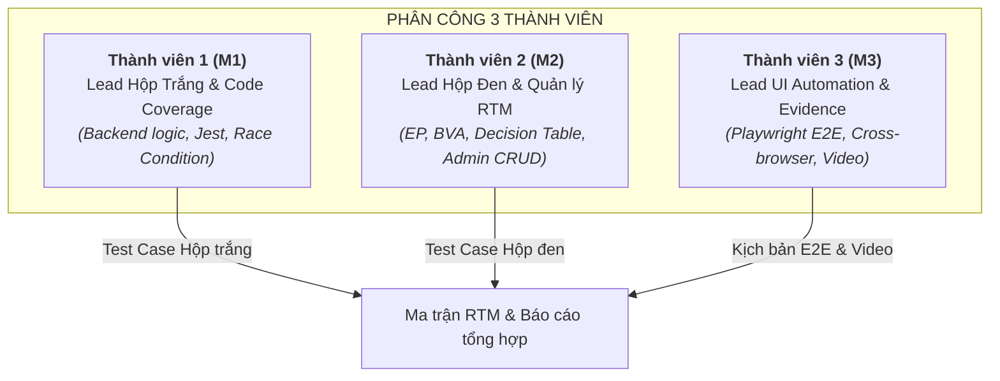

# 📋 KẾ HOẠCH & LỘ TRÌNH KIỂM ĐỊNH CHẤT LƯỢNG PHẦN MỀM
> **Dự án:** Website Bán Quần Áo (`website-ban-quan-ao`)  
> **Thời gian thực hiện:** 1 Tuần (Sprint 7 ngày)  
> **Quy mô nhóm:** 3 Thành viên (M1, M2, M3)  
> **Mục tiêu:** Hoàn thành bài tập lớn môn Kiểm định & Đảm bảo chất lượng phần mềm, đạt điểm tối đa theo Rubric.

---

## 👥 I. PHÂN CHIA VAI TRÒ & NHIỆM VỤ (3 THÀNH VIÊN)



---

### 👤 1. Thành viên 1 (M1): Lead Hộp Trắng & Kiểm Thử Đồng Thời (White-box Focus)
* **Module đảm nhiệm:**
  * `user/controllers/authController.js` (Đăng ký, Đăng nhập, Mã hóa mật khẩu `bcryptjs`).
  * `user/controllers/cartController.js` (Thêm giỏ hàng, Cộng dồn số lượng theo size/biến thể, Tính tổng tiền).
  * `user/controllers/orderController.js` (Trừ kho an toàn nguyên tử bằng atomic update).
  * `user/controllers/shipperController.js` (Hàm tính hoa hồng shipper `calcShipperEarning`).
* **Công cụ:** `Jest`, `Supertest`, `mongodb-memory-server`.
* **Nhiệm vụ cụ thể:**
  1. Viết Unit Test bao phủ các nhánh điều kiện (`if/else`, validation, try/catch).
  2. Đo độ phủ bằng lệnh `npx jest --coverage`, cam kết **Coverage $\ge 85\%$**, chụp ảnh báo cáo HTML phủ xanh làm minh chứng.
  3. **Kiểm thử nâng cao (Race Condition):** Viết script gửi 15-20 request đặt hàng đồng thời khi sản phẩm chỉ còn tồn kho = 1 để chứng minh kho hàng không bị âm.

---

### 👤 2. Thành viên 2 (M2): Lead Hộp Đen, Kỹ Thuật Kiểm Thử & Quản Trị RTM
* **Module đảm nhiệm:**
  * Form nhập liệu toàn hệ thống (Đăng ký, Đăng nhập, Giỏ hàng).
  * Phân hệ `admin` (Port 3001): CRUD Sản phẩm (upload ảnh Multer), Danh mục, Cập nhật trạng thái đơn hàng.
* **Công cụ:** Excel / Markdown, Postman / Supertest.
* **Nhiệm vụ cụ thể:**
  1. **Thiết kế kỹ thuật Hộp đen:**
     * Bảng **Phân lớp tương đương (EP)** & **Phân tích giá trị biên (BVA)** cho các trường: Số lượng mua (âm, 0, 1, tồn kho, vượt kho, chữ), Giá sản phẩm, Email, Mật khẩu.
     * **Bảng quyết định (Decision Table)** cho quy trình duyệt đơn và hủy đơn hàng.
  2. Kiểm thử chức năng Admin và ghi nhận kết quả thực tế (Pass/Fail).
  3. **Chủ trì Ma trận truy vết yêu cầu (RTM):** Ánh xạ `Mã yêu cầu (REQ)` $\leftrightarrow$ `Test case Hộp đen` $\leftrightarrow$ `Test case Hộp trắng`.
  4. **Kiểm thử nâng cao (Fuzzing Data):** Bơm dữ liệu dị thường (chuỗi cực dài > 10.000 ký tự, NoSQL injection `{"$gt": ""}`) vào các ô tìm kiếm và đăng nhập xem server có xử lý an toàn không.

---

### 👤 3. Thành viên 3 (M3): Lead Tự Động Hóa Giao Diện & Bằng Chứng (UI Automation)
* **Module đảm nhiệm:**
  * Giao diện App User (Port 3000): Trang chủ, Tìm kiếm, Lọc theo danh mục, Chi tiết sản phẩm, Giỏ hàng, Đặt hàng.
* **Công cụ:** `Playwright` (Node.js).
* **Nhiệm vụ cụ thể:**
  1. Viết 3 kịch bản E2E tự động:
     * **Kịch bản 1:** Tìm kiếm sản phẩm $\rightarrow$ Lọc danh mục $\rightarrow$ Xem trang chi tiết.
     * **Kịch bản 2:** Chọn size L $\rightarrow$ Thêm vào giỏ hàng $\rightarrow$ Đổi số lượng $\rightarrow$ Kiểm tra tổng tiền tự động tính lại.
     * **Kịch bản 3:** Điền địa chỉ giao hàng $\rightarrow$ Đặt hàng $\rightarrow$ Kiểm tra đơn hàng hiển thị trong tài khoản.
  2. **Kiểm thử nâng cao (Cross-browser):** Cấu hình Playwright chạy trên cả **Chromium (Chrome)** và **Firefox**.
  3. **Xuất bằng chứng:** Cấu hình Playwright tự động quay **Video màn hình** và chụp **Ảnh chụp màn hình (Screenshots)** lưu vào thư mục `tests/evidence/`.

---

## ⏱️ II. LỘ TRÌNH 7 NGÀY "CHẠY NƯỚC RÚT" (DAILY SPRINT)

| Ngày | Mục tiêu chính | Chi tiết công việc từng người |
| :---: | :--- | :--- |
| **Ngày 1**<br>*(Thứ 2)* | **Setup & Khung dự án** | • Cả nhóm: Tạo Git repo, chia 3 branch (`m1/whitebox`, `m2/blackbox-rtm`, `m3/ui-playwright`). Cài đặt `jest`, `supertest`, `@playwright/test`.<br>• M2: Liệt kê danh sách yêu cầu (`REQ-01` đến `REQ-06`) và dựng file Excel RTM.<br>• M1, M3: Chạy thử `start.bat` xác nhận hệ thống chạy mượt trên máy. |
| **Ngày 2**<br>*(Thứ 3)* | **Thiết kế Hộp đen & Bắt đầu Code** | • M2: Hoàn thiện bảng phân tích EP & BVA (15-20 test case) + Bảng quyết định.<br>• M1: Viết Unit Test cho `authController` (login/register/hash password).<br>• M3: Khởi tạo Playwright, viết kịch bản mở web, tìm kiếm và lọc sản phẩm. |
| **Ngày 3**<br>*(Thứ 4)* | **Hộp trắng nâng cao & E2E Checkout** | • M1: Viết Unit Test cho `cartController` & `orderController` (trừ kho, tính giá).<br>• M3: Hoàn thành kịch bản Playwright luồng mua hàng (Thêm giỏ $\rightarrow$ Checkout).<br>• M2: Kiểm thử tính năng Admin (Thêm sản phẩm, cập nhật đơn hàng) và điền mã test case vào RTM. |
| **Ngày 4**<br>*(Thứ 5)* | **Đo Coverage & Kiểm thử nâng cao** | • M1: Chạy `npx jest --coverage`, tối ưu đạt **Coverage $\ge 85\%$**, viết script test **Race Condition (Đặt hàng đồng thời)**.<br>• M3: Chạy Playwright trên Chromium + Firefox, xuất video và screenshot vào `tests/evidence/`.<br>• M2: Viết script Fuzzing dữ liệu dị thường. |
| **Ngày 5**<br>*(Thứ 6)* | **Quy trình GitHub & Review chéo** | • Cả nhóm: Tạo 3 Pull Request (PR) tương ứng 3 branch lên nhánh `main`.<br>• **Quy định:** Mỗi PR phải có 2 thành viên khác vào bấm "Review", để lại comment nhận xét kỹ thuật rồi mới Merge.<br>• Tạo 3-5 Issues trên GitHub, gán nhãn `bug`, `white-box`, `black-box` rồi đóng lại để lấy trọn 0.5đ Git. |
| **Ngày 6**<br>*(Thứ 7)* | **Viết Báo cáo tổng hợp** | • Chia phần viết báo cáo (Mỗi người viết 12-15 trang):<br>  - M1: Phần Hộp trắng, bảng CFG, ảnh chụp Coverage xanh, biểu đồ Race Condition.<br>  - M2: Phần Hộp đen, bảng EP/BVA, Bảng quyết định, Ma trận RTM tổng hợp, kết quả Fuzzing.<br>  - M3: Phần Tự động hóa Playwright, kịch bản E2E, hình ảnh kết quả đa trình duyệt và link video.<br>• Ghép file thành 1 bản báo cáo hoàn chỉnh $\approx 45 - 50$ trang. |
| **Ngày 7**<br>*(Chủ nhật)* | **Rà soát Barem & Luyện tập Demo** | • Đối chiếu lại từng mục trong Rubric để đảm bảo không sót điểm nào.<br>• Làm slide thuyết trình (10-12 slides tóm tắt).<br>• Chạy thử lại toàn bộ lệnh test tự động để sẵn sàng bảo vệ. |

---

## 🏆 III. CHIẾN LƯỢC ĐẠT ĐIỂM TỐI ĐA (CHECKLIST THEO BAREM RUBRIC)

| Tiêu chí Rubric | Điểm | Điểm nhấn giúp nhóm đạt điểm tuyệt đối |
| :--- | :---: | :--- |
| **1. Chương trình thực nghiệm** | **1.5đ** | Dự án có đủ cả 2 phân hệ (User + Admin), mô hình 3 role (User, Admin, Shipper), cơ sở dữ liệu MongoDB thực tế và logic xử lý nghiệp vụ phong phú. |
| **2. Kiểm thử Hộp đen** | **1.5đ** | Bảng **Phân lớp tương đương (EP)** và **Giá trị biên (BVA)** chi tiết cho các trường số (giá, tồn kho) và chuỗi (email, phone); Bảng quyết định trạng thái đơn; Ma trận **RTM** truy vết 2 chiều giữa REQ và test cases. |
| **3. Kiểm thử Hộp trắng** | **1.5đ** | Vẽ **Đồ thị dòng điều khiển (CFG)** cho hàm tính giá giỏ hàng/trừ kho, tính độ phức tạp chu trình $V(G)$ và đính kèm ảnh chụp màn hình **Jest Coverage phủ xanh $\ge 85\%$**. |
| **4. Kiểm thử Tự động** | **1.0đ** | Sử dụng Jest cho Unit Test tự động, Playwright cho E2E UI Test tự động. Chạy được toàn bộ kịch bản bằng 1 câu lệnh `npm test`. |
| **5. Kiểm thử Nâng cao** | **1.0đ** | **M1:** Concurrency / Race Condition Test kiểm tra tính toàn vẹn tồn kho.<br>**M2:** Fuzzing Test dữ liệu dị thường.<br>**M3:** Cross-browser Testing trên Chromium và Firefox, có video quay lại. |
| **6. Quản lý GitHub** | **0.5đ** | Chia 3 branch cá nhân, sử dụng Git Flow chuẩn, mở Issue có gắn label (`bug`, `white-box`, `black-box`), tạo Pull Request có tối thiểu 2 review comment trước khi merge. |
| **7. Báo cáo tổng kết** | **1.5đ** | Báo cáo chi tiết, chuyên nghiệp từ 3 thành viên ($\approx 50$ trang), đầy đủ biểu đồ, bảng biểu, ảnh chụp bằng chứng coverage và link video minh họa. |

---

## 📂 IV. CẤU TRÚC THƯ MỤC TEST CHUẨN TRONG DỰ ÁN

```text
website-ban-quan-ao/
├── admin/                     # Mã nguồn Admin app (Port 3001)
├── user/                      # Mã nguồn User app (Port 3000)
├── tests/
│   ├── Unit/                  # Kiểm thử Hộp trắng (M1)
│   │   ├── authController.test.js
│   │   ├── cartController.test.js
│   │   └── orderController.test.js
│   ├── Advanced/              # Kiểm thử Nâng cao
│   │   ├── race_condition_stock.js  # Script bắn 20 request đồng thời (M1)
│   │   └── fuzzing_payloads.js      # Script bơm dữ liệu dị thường (M2)
│   ├── e2e/                   # Kiểm thử Giao diện Playwright (M3)
│   │   ├── playwright.config.js
│   │   └── customer_journey.spec.js
│   ├── BlackBox_Specs/        # Tài liệu đặc tả Hộp đen (M2)
│   │   ├── EP_BVA_Analysis.xlsx
│   │   └── RTM_Traceability_Matrix.xlsx
│   └── evidence/              # Minh chứng chạy tự động
│       ├── screenshots/
│       ├── videos/
│       └── coverage/          # Báo cáo HTML sinh từ Jest
```
